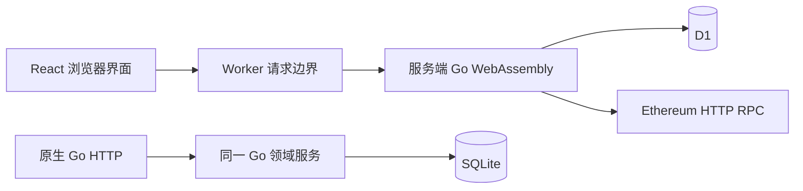

# 架构与取舍

## 一条实际请求

Sites 使用 Workers，不能运行常驻 Go 进程，因此采用标准 Go js/wasm 承载领域逻辑。运行时按隔离实例复用，请求独立传入数据库绑定、身份和配置。浏览器不持有数据库或服务密钥。原生入口用于本地 API 开发与测试，和线上复用同一份校验、SQL 与排序代码。

没有引入 Redis、消息队列或分布式锁。当前读写规模与依赖数不需要这些组件；限制候选集、唯一约束、数据库批次和版本比较足以表达首版的一致性要求。Go 产物较大，首次初始化存在成本，不能由本地轻载结果推断高并发容量。

## 笔试体验路径

默认启用 `ExperienceMode`：12 篇内容与 6 条交互记录为只读内存数据，和 3 篇官方资料共同进入有界候选集；个人发布、收藏、反馈、偏好与精选仍写入 D1/SQLite。每个访客使用独立会话，服务端通过 can_publish 授权发文，不创建虚构钱包地址或签名。

记录关联只接受应用白名单，检查作者和 revision 后一次更新，状态为 recorded。页面调整使用有限规则修改配色、版式、标题与简介，再走现有版本事务。这两条路径不调用 RPC 或外部创作服务。关闭该配置后恢复原钱包发布门槛；下述主网链路为保留的可选实现。

## 数据和 IO 边界

| 链路 | 读写与一致性 | 失败处理 |
| --- | --- | --- |
| 内容流 | 最多 200 候选；作者一次关联，互动一次聚合；每页 12 项 | 快照 15 分钟，过期要求刷新 |
| 推荐 | 明确标签、收藏应用、新鲜度、有限有用反馈、很小的凭据加分；同应用重复扣分 | 不感兴趣排除；理由对应实际信号 |
| 签名登录 | 挑战绑定完整 origin、会话、地址与 5 分钟期限；原子消费 | 重放拒绝；新会话令牌轮换；旧令牌失效 |
| 发布与编辑 | 用户内幂等键 + 内容摘要；revision 条件更新 | 重复写入不新增；冲突返回 409 |
| 收藏与有用 | 用户 + 文章 + 类型唯一；写目标状态 | 重试不反转、不重复累计 |
| 排除反馈 | 事件唯一与状态变更同事务 | 旧事件不能覆盖后来的撤销 |
| 精选页 | 最多 50 页，每页 50 版本；当前与历史同批事务 | 竞争失败不产生孤立历史 |
| 交互凭据 | 事务外最多两批共五个 RPC 方法，总时限 8 秒 | 返回待确认、不可用、拒绝或已核验；不自动无限重试 |

快照只固定顺序与推荐理由，翻页仍重新检查删除、排除、收藏及凭据状态。排序为最多 200 个元素的内存计算，不在循环内逐条访问数据库或链服务。启动迁移和 SQL 驱动内部批次属于适配边界，不承诺它们没有内部循环。

## 身份与隔离

平台控制网站访问权限；应用使用独立社区会话，可选钱包路径使用签名身份。会话只保存令牌摘要，并绑定平台注入的用户标识。浏览器 Cookie 使用 HttpOnly、SameSite=Lax，HTTPS 下启用 Secure。

只允许游客数据合并到签名身份；已登录的钱包切换不会迁移前一钱包的内容。文章修改、删除、凭据核验与私人精选读取均使用服务端用户 ID 约束。公开的作者钱包地址来自用户主动签名发布这一流程，精选 HTML 不携带账户、会话或偏好数据。

写入检查同源、专用请求头与 JSON 媒体类型。请求体 64 KiB，上游响应有大小上限。会话创建、写入、签名、凭据、外部调整各有分钟级限额。请求日志含 request_id、路径、状态和耗时，不记录正文、令牌与密钥。

## 凭据的含义

仅覆盖目录中登记的 Ethereum 主网合约，检查发送者、成功回执、目标合约、规范区块哈希与至少 12 个确认。合约目录与客户端输入分离，不能通过请求扩展允许范围。它不证明作者为唯一真人、评价客观、应用安全或未来结果。

## 精选页面

用户选择内容、标题、版式与主题后，Go 编译独立 HTML。模板对内容转义，预览 iframe 只放行脚本，导出使用 CSP sandbox；页面可搜索与分类。历史版本保存完整内容快照，后续编辑不改旧版。

可选外部调整只接受有限结构，应用及文章 ID 仍固定为用户原选择。默认使用本地有限字段调整；关闭完整体验后才读取外部配置。“任意一句话构建任意应用”不在已验证能力内。

## 可讨论的下一阶段

真实使用数据积累后，才比较不同召回和排序策略；事件需配套保留周期与离线效果评估。扩大目录时需要来源维护和内容治理；规模扩大后再考虑独立缓存、后台凭据任务和更细的限流隔离。当前未声称完成这些能力。
